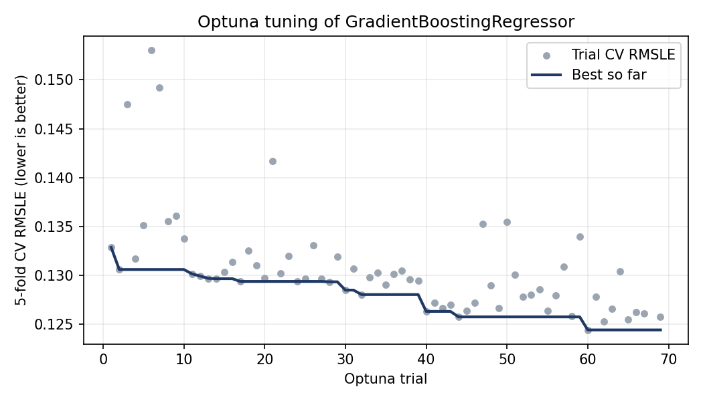
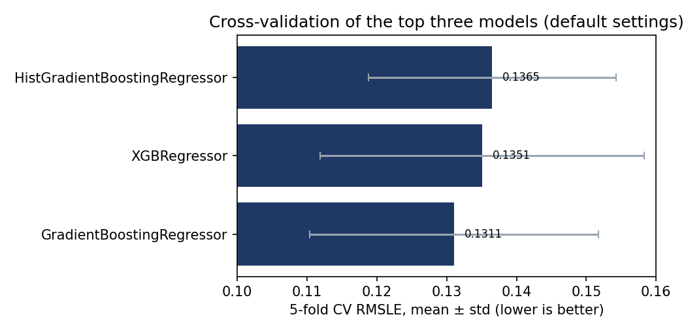

# House Prices: Advanced Regression


**Kaggle public leaderboard score: 0.12846 (RMSLE)** · Tuned `GradientBoostingRegressor` · 6 model families benchmarked · Optuna tuning · YAML-driven pipeline with unit tests

A configuration-driven machine learning project for predicting residential property prices using the Kaggle **House Prices: Advanced Regression Techniques** competition.

The project explores an end-to-end regression workflow, including exploratory data analysis, preprocessing, model benchmarking, cross-validation, hyperparameter optimization, model evaluation, and Kaggle submission generation.

## Project Objectives

- Build a modular and reusable machine learning workflow.
- Keep experiment settings and pipeline parameters in a YAML configuration file.
- Compare different regression algorithms using consistent evaluation procedures.
- Use cross-validation and Optuna for hyperparameter optimization.
- Evaluate model performance using Root Mean Squared Logarithmic Error (RMSLE).
- Generate predictions in the format required by the Kaggle competition.

## Dataset

The project uses the [House Prices: Advanced Regression Techniques](https://www.kaggle.com/competitions/house-prices-advanced-regression-techniques) dataset.

| Property | Description |
|---|---|
| Training observations | 1,460 |
| Test observations | 1,459 |
| Training columns | 81 |
| Test columns | 80 |
| Target variable | `SalePrice` |
| Identifier | `Id` |
| Task | Supervised regression |

The dataset contains numerical and categorical property characteristics. The target variable, `SalePrice`, represents the property's sale price.

**Dataset access:** The project uses the Kaggle API. You must have access to the competition data and configure your Kaggle credentials before downloading it.

## Project Structure

```text
advanced_regression_housing_price/
├── config/
│   └── config.yaml
├── docs/images/               # figures used in this README
├── notebook/
│   └── eda.ipynb
├── reports/
│   ├── best_hyperparameters.json
│   ├── cross_validation_results.csv
│   ├── final_model_metadata.json
│   └── optuna_trials.csv      # (optuna_studies.db is generated locally, not committed)
├── src/
│   ├── config_loader.py
│   ├── cross_validation.py
│   ├── diagnostic.py
│   ├── evaluate_tuned_model.py
│   ├── evaluation.py
│   ├── finalize_model.py
│   ├── load_data.py
│   ├── logger.py
│   ├── main.py
│   ├── models.py
│   ├── preprocessor.py
│   ├── split.py
│   ├── submission.py
│   ├── train.py
│   └── tuning.py
├── tests/                     # pytest unit tests
├── .github/workflows/ci.yml   # runs the tests on every push
├── requirements.txt
├── requirements-dev.txt
└── LICENSE
```

Generated datasets, model artifacts, logs, and other outputs may be stored locally and are excluded from version control according to `.gitignore`.

## Workflow and Architecture

The project separates major responsibilities into modules to make the workflow easier to maintain and extend.

### 1. Configuration Management

`config/config.yaml` stores project settings, while `src/config_loader.py` provides configuration-loading functionality.

This approach reduces the need to hardcode experiment settings throughout the codebase.

### 2. Data Loading and Splitting

- `src/load_data.py` handles dataset loading through the Kaggle API.
- `src/split.py` handles the data-splitting logic.

The competition's test dataset does not include the target variable, so it is used for generating submission predictions rather than evaluating model performance against known labels.

### 3. Exploratory Data Analysis

`notebook/eda.ipynb` contains the exploratory analysis of the dataset, including investigation of feature types, missing values, relationships between variables, and potential preprocessing requirements.

### 4. Preprocessing

`src/preprocessor.py` contains the preprocessing components and transformer construction.

The project uses scikit-learn preprocessing tools, including imputers, encoders, column transformations, and pipelines. Keeping preprocessing within the machine learning workflow helps maintain consistent transformations between training and prediction.

### 5. Model Benchmarking

`src/models.py` defines the candidate models, and `src/train.py` handles model-training functionality.

The candidate algorithms include:

- Ridge Regression
- Random Forest
- Gradient Boosting
- XGBoost
- LightGBM
- CatBoost

Additional scikit-learn regression estimators are available in the model definitions.

### 6. Cross-Validation

`src/cross_validation.py` implements cross-validation functionality, while `src/evaluation.py` handles model evaluation.

Cross-validation provides a more robust comparison than relying on a single validation split. The primary competition metric is RMSLE, for which lower values indicate better performance.

### 7. Hyperparameter Optimization

`src/tuning.py` contains the Optuna-based tuning workflow.

The tuning results and experiment artifacts are stored in the `reports/` directory, including the best hyperparameters, trial results, and Optuna study database.

### 8. Final Model and Diagnostics

- `src/evaluate_tuned_model.py` evaluates tuned-model performance.
- `src/finalize_model.py` handles final-model preparation.
- `src/diagnostic.py` provides diagnostic functionality.

### 9. Kaggle Submission

`src/submission.py` handles submission-related functionality. The generated submission must contain the competition's identifier column, `Id`, and the predicted target column, `SalePrice`.

## Feature Engineering and Preprocessing

All preprocessing lives in `src/preprocessor.py` as scikit-learn transformers, so the same steps are applied during training, cross-validation and prediction. Feature lists and category orders are defined in `config/config.yaml`, not in code.

- **Structural features:** `GarageExist` and `BsmtExist` flags derived from whether the garage year and basement condition are present; missing garage/basement numerics are set to 0 and missing categories to `"None"`, because a missing value here means the house has no garage or basement.
- **Masonry veneer repair:** `MasVnrFeatureEngineer` fixes inconsistent area/type pairs, for example filling a missing type from the most frequent type when the area is large, and estimating a zero area from the median area of that type.
- **LotFrontage imputation:** neighbourhood median, falling back to the overall median for unseen neighbourhoods.
- **Skewness:** `log1p` transform on `LotFrontage`, `MiscVal` and `LotArea`.
- **Ordinal encoding:** quality, exposure, basement finish, garage finish, fence and paved-drive columns are encoded with explicit category orders rather than arbitrary integers.

## Results

| Evaluation | RMSLE |
|---|---:|
| Baseline validation | 0.138690 |
| Tuned Gradient Boosting validation (20% holdout) | 0.135991 |
| Best Optuna trial, 5-fold cross-validation | 0.124434 |
| **Kaggle public leaderboard** | **0.12846** |

Tuning improved the holdout validation RMSLE by about **1.95%** over the baseline (0.138690 to 0.135991).





**How to read these numbers**

- Six model families were benchmarked on one holdout split. The three strongest (Gradient Boosting, HistGradientBoosting, XGBoost) were cross-validated, and Gradient Boosting was tuned with Optuna.
- The 0.1244 cross-validation figure is the best of 68 completed trials, selected on the same folds it is scored on, so it is optimistic. The holdout score and the Kaggle leaderboard score are the more honest estimates.
- The three scores are measured differently and are not directly interchangeable.
- The final model is trained on all 1,460 labelled rows, so it has no separate validation score.

## Testing

```
pip install -r requirements-dev.txt
python -m pytest -q
```

The tests cover the custom transformers (`StructuralFeatureEngineer`, `MasVnrFeatureEngineer`, `LotFrontageImputer`, `SkewnessTransformer`, ordinal encoding), the Kaggle submission checks (schema, row count, negative and non-finite predictions) and the configuration file. They run automatically on every push through GitHub Actions.

## Tech Stack

- Python
- pandas and NumPy
- scikit-learn
- XGBoost
- LightGBM
- CatBoost
- Optuna
- SciPy
- Matplotlib and Seaborn
- PyYAML
- Kaggle API
- Jupyter Notebook

See `requirements.txt` for the project's pinned Python dependencies.

## Setup

### 1. Clone the repository

```bash
git clone https://github.com/Naimul013/advanced_regression_housing_price.git
cd advanced_regression_housing_price
```

### 2. Create and activate a virtual environment

On Linux or WSL:

```bash
python3 -m venv .venv
source .venv/bin/activate
```

### 3. Install dependencies

```bash
python -m pip install --upgrade pip
pip install -r requirements.txt
```

### 4. Configure Kaggle access

Configure your Kaggle API credentials according to the [Kaggle API documentation](https://github.com/Kaggle/kaggle-api).

Ensure that your credentials are kept private and are never committed to the repository.

### 5. Configure the project

Review `config/config.yaml` and adjust the dataset, paths, experiment settings, and model parameters as required.

### 6. Run the workflow

Run every command from the project root, using `python -m` so the `src` package imports resolve. Each step reads its settings from `config/config.yaml`.

| Step | Command | What it does |
|---|---|---|
| 1 | `python -m src.main` | Downloads the data, benchmarks baseline and candidate models, cross-validates the top three, writes `reports/cross_validation_results.csv` |
| 2 | `python -m src.tuning` | Runs Optuna trials for `GradientBoostingRegressor`, writes `reports/best_hyperparameters.json` and `reports/optuna_trials.csv` |
| 3 | `python -m src.evaluate_tuned_model` | Scores the tuned model on the held-out validation split |
| 4 | `python -m src.finalize_model` | Retrains the tuned model on all labelled rows and saves it with metadata |
| 5 | `python -m src.submission` | Validates predictions and writes `submissions/submission.csv` for Kaggle |

## Reproducibility

The project uses centralized configuration and records experiment outputs to support reproducibility. Reproducing the exact results may also depend on the Python environment, dependency versions, random seeds, dataset access, and saved experiment artifacts.

## Limitations and Future Improvements

- Only `GradientBoostingRegressor` was tuned; tuning XGBoost, LightGBM and CatBoost the same way is the obvious next experiment.
- Try an ensemble (stacking or blending) of the strongest tuned models.
- Use nested cross-validation for an unbiased estimate of the tuned model.
- Add tests for the data-loading and tuning modules, which currently need Kaggle credentials.
- Track experiments with a dedicated tool such as MLflow instead of JSON and CSV files.
- eda notebook is very messy, I kept it like that deliberately as at different stages i had to change my strategy. That is something i will be working next.

## Author

**Md Naimul Islam Nahid**

AI undergraduate, University of Greenwich (London)

GitHub: [@Naimul013](https://github.com/Naimul013) · [LinkedIn](https://www.linkedin.com/in/md-naimul-islam-nahid)
